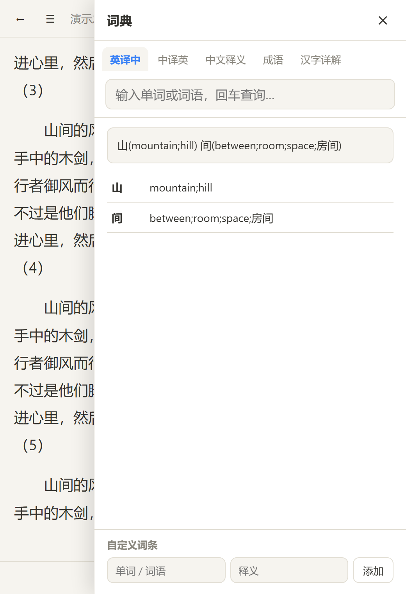

# 📖 Float Reader · 浮窗小说阅读器

一个**置顶浮窗小说阅读器**:无边框迷你桌面窗口,边干活边看小说;内容与分页随窗口大小自动重排。纯本地离线,内置中/英/日界面与划词翻译词典,数据全部存本机。

<div align="center">
   
</div>

## 📥 下载使用(推荐)

到 [**Releases**](../../releases) 下载 **`FloatReader.exe`**(单文件,内置全部资源),双击即用:

- 无需安装、无需 Python、无需浏览器——Windows 10/11 直接运行
- 启动即是屏幕正中的无边框悬浮窗:标题栏右侧 📌 一键置顶,─ □ × 窗口控制,拖边缘缩放
- 首次打开导入本地 txt / md 即可开始阅读

> 自包含原理:exe 内嵌 `index.html`,首次运行释放到 `%APPDATA%\FloatReader\`;若 exe 旁边放了 `index.html` 则优先使用旁边那份(开发者模式)。

## ✨ 功能

| 功能 | 说明 |
| --- | --- |
| 🪟 浮窗 | 桌面模式窗口默认悬浮居中,📌 随时置顶/取消;浏览器模式另有画中画浮窗(Chrome / Edge 116+) |
| 📥 导入 | `.txt` / `.md` 多选,自动识别 **UTF-8 / GBK / Big5** 编码;支持直接粘贴文本 |
| 📚 书库 | 书籍、章节、阅读进度存于本机 IndexedDB,重启不丢失 |
| 📑 分章 | 自动识别「第 X 章 / 卷 / 序章 / 番外 / Chapter N」等标题;切不出章节时按长度自动分段 |
| 📄 排版 | 列式精准分页(非滚动翻页),‹ › 按钮 / 键盘 ←→ / 点击页面左右热区 / 触屏滑动均可翻页;窗口缩放实时重排 |
| 🔖 进度 | 按字符偏移记录阅读位置,重开精确恢复;书库显示进度百分比 |
| 🌐 三语 | 界面中文 / English / 日本語,🌐 按钮弹出语言菜单,默认跟随系统语言,选择持久保存 |
| 🔍 划词 | 选中正文弹出 **翻译 / 朗读 / 复制**;内嵌离线词典(英译中 / 中译英 / 中文释义 / 成语 / 汉字详解,约 1.4 万条),整句逐词翻译、词干还原;支持自定义词条(优先于内置词典) |
| 🔤 字号 | A+ / A- 调节,持久保存 |

## 🖥 桌面应用

- **免打包**:直接用 Releases 的 `FloatReader.exe`(单文件自包含)
- **从源码运行**:`pip install pywebview && python desktop/main.py`
- **自己打包**:
  ```bash
  pyinstaller -F -w --name FloatReader --add-data "index.html;." desktop/main.py
  ```
- 桌面壳:无边框 + 自绘标题栏(左侧拖拽区,右侧 📌 置顶与 ─ □ × 窗口控制),支持拖拽移动、拖边缘缩放、双击标题栏最大化;书与进度存于 `%APPDATA%\FloatReader`

## 🌏 浏览器模式

直接双击 `index.html` 用 Chrome / Edge 打开即为网页版;阅读时点工具栏 **⧉** 可把正文移入系统级画中画置顶小窗。数据与桌面模式相互独立(各存各的 IndexedDB)。

> 也可以打开 `index.html?demo=1` 体验内置演示书。

## 🧱 项目结构

```
float-reader/
├── index.html        # 整个 Web 应用(单文件,内嵌离线词典)
├── desktop/
│   └── main.py       # pywebview 桌面壳(无边框自绘标题栏)
├── doc/screenshot.png
└── README.md
```

`index.html` 内部按区块组织:工具函数 → 词典数据(RAW_DICTS)→ 词典服务 → I18N 词条 → IndexedDB 封装 → 文本处理(编码检测/分章)→ 列式分页器 → 画中画 → 阅读器 → 书库 → 应用装配。

## 🙏 致谢

- 词典数据、词典服务与划词翻译交互移植自同作者的 **offline-novel-reader** 项目
- 桌面壳基于 [pywebview](https://pywebview.flowrl.com/)

## 📄 License

[MIT](LICENSE)

## 🧱 实现要点

- **分页**:`#page-inner` 用 CSS 多列(`column-fill:auto` + 固定高),一列即一页,`translateX` 翻页;resize / 字号变化后重新测量,并用 `Range` 几何定位按字符偏移恢复到原阅读位置。
- **浮窗**:Document Picture-in-Picture API。`#reader` 节点(含工具栏与目录抽屉)整体移入 PiP 文档,样式表逐条复制,元素引用与事件监听随节点保留;`pagehide` 时移回主窗口。
- **章节加载**:按 `[bookId, seq]` 复合键区间读取,书库与阅读互不加载多余数据。
